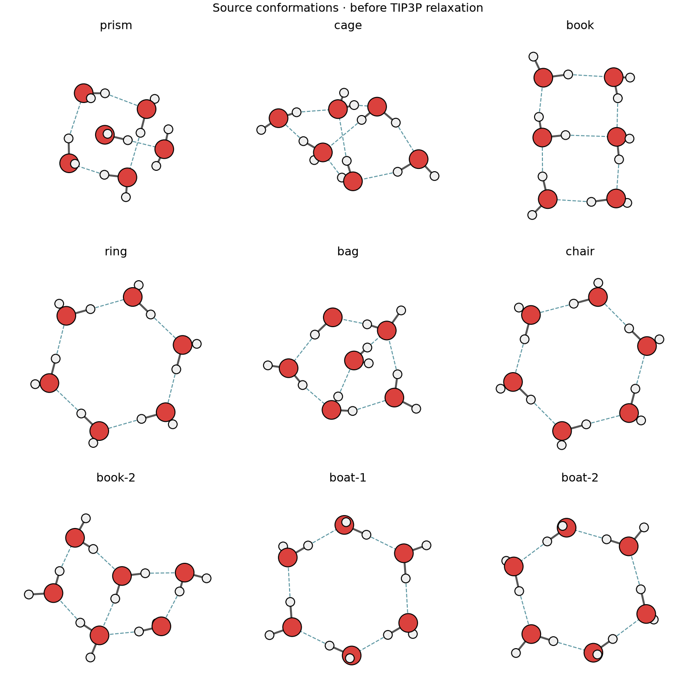
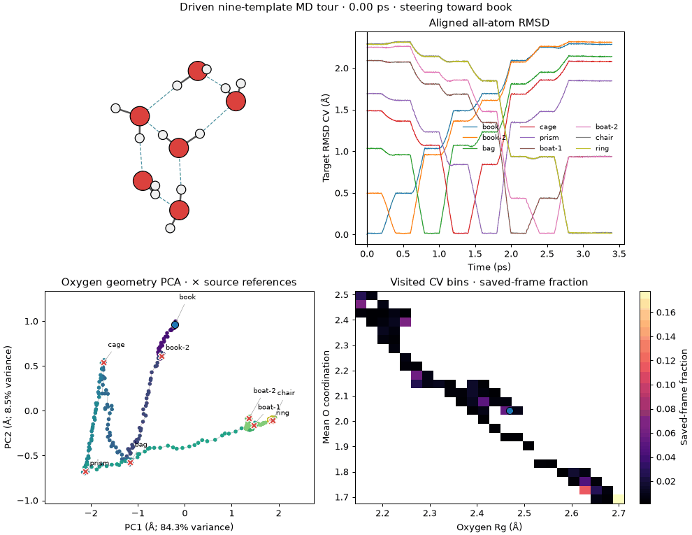
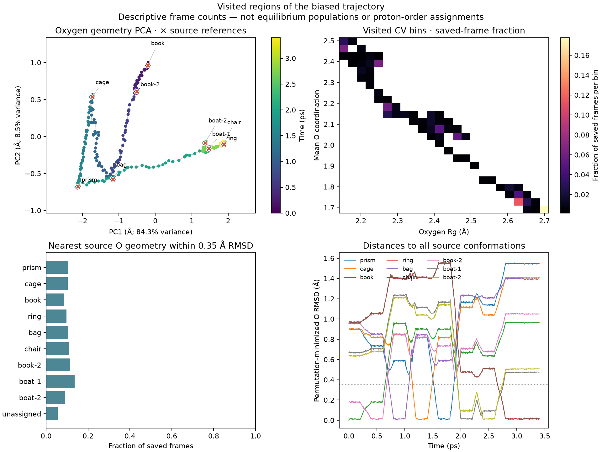
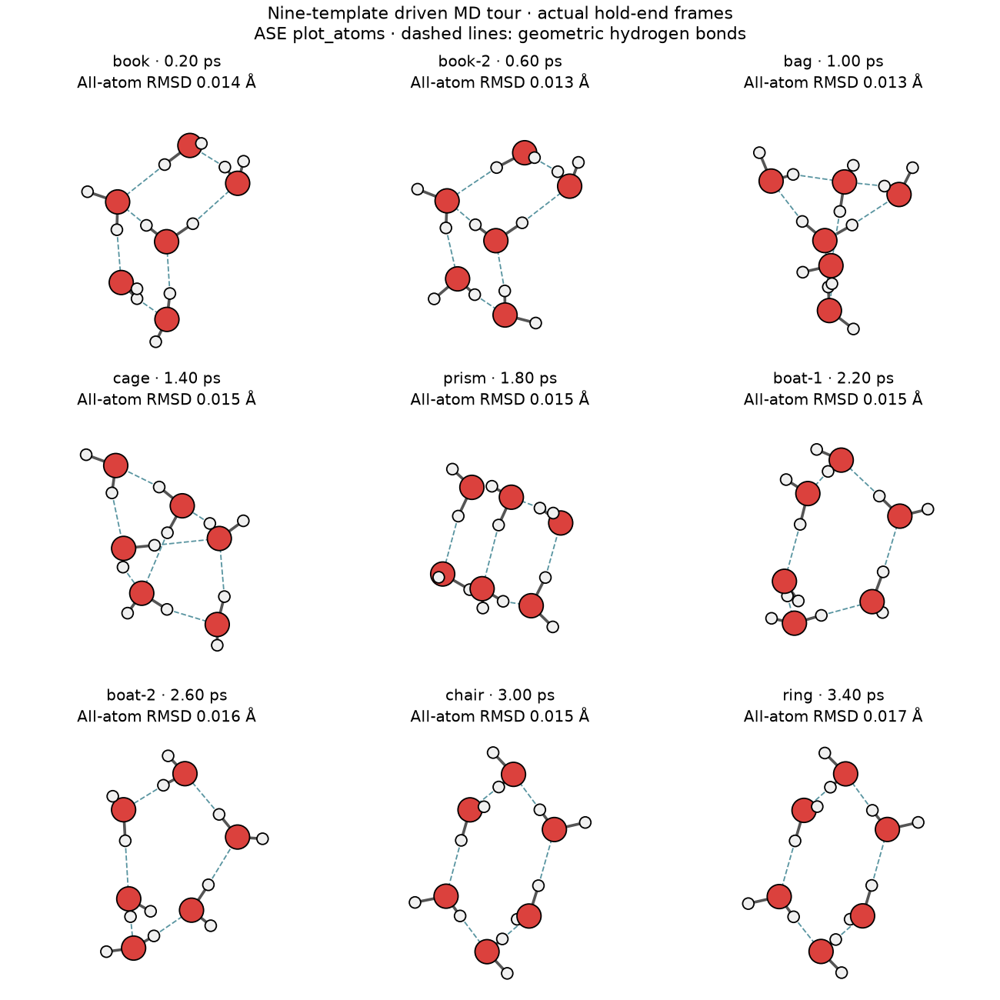
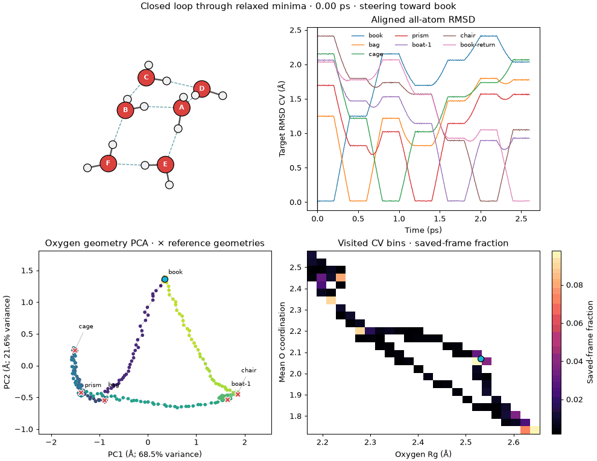
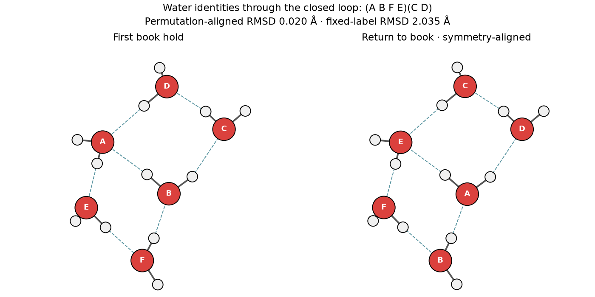

.. _engine-plumed:

PLUMED
======

.. list-table::
   :header-rows: 1

   * - Official website
     - How is metatomic supported?
   * - https://www.plumed.org/
     - In the official (development) version

The `metatomic` interface for `PLUMED <https://www.plumed.org/>`_ allows using
an exported :py:class:`AtomisticModel` to compute arbitrary functions of the
atomic coordinates, using them as collective variables to perform advanced
sampling such as metadynamics. Below we also provide a minimal example of the
implementation of a minimalist, model that is compatible with this interface.
See also `this recipe
<https://atomistic-cookbook.org/examples/metatomic-plumed/metatomic-plumed.html>`_
for more realistic, complex demonstrations.

Experimental core API example
^^^^^^^^^^^^^^^^^^^^^^^^^^^^^

An executable `water-hexamer example
<https://github.com/EricBoittier/metatomic/tree/codex/plumed-core-api-docs/examples/plumed-water-hexamers>`_
explores the forthcoming core API using pinned development sources. It includes
analytic CV position/strain derivatives, short ASE biased dynamics, a book/prism
CV scan, a nine-template RMSD-driven tour, trajectory plots, and
NumPy/PyTorch/JAX tests through PLUMED.

This is a draft for the new interface, separate from the released TorchScript
workflow described below. The Python backend tests use a test-only C ABI adapter
because the pinned revision has no production Python model loader. The example
documents the feature-gradient consistency-validator limitation and the limits
of interpreting a short CV scan as an isomer conversion. Its build recipe is
currently macOS-specific.

The example includes nine reference conformations: prism, cage, book, ring,
bag, chair, book-2, boat-1 and boat-2. These source geometries are shown before
TIP3P relaxation; similar oxygen geometries need not have identical proton order.

   Source conformations. Original coordinates and provenance are included with
   the example; atom order is normalized to six OHH groups.

   Continuous 3.4 ps targeted MD tour of all nine reference templates at 200 K.
   The aligned all-atom RMSD CVs include hydrogen positions and exclude
   reflections. Blue markers follow the current frame; the PCA and histogram
   use the whole saved trajectory. These are driven visits, not spontaneous
   transitions or equilibrium populations.

   Descriptive coverage of 681 saved frames. PCA is fitted to centered, unscaled,
   sorted O–O distances from the trajectory only; source references are projected
   afterward. Histogram bins show fractions of saved frames, not equilibrium
   probabilities. The nearest reference count uses an illustrative 0.35 angstrom
   oxygen RMSD cutoff and leaves more distant frames unassigned. Neither
   projection identifies proton ordering or establishes a free-energy surface.

   Actual hold-end frames. A separate audit requires all-atom RMSD below
   0.15 angstrom, source oxygen RMSD below 0.15 angstrom, and matching directed
   hydrogen bonds for at least three consecutive saved frames at every target.
   Ring and chair are separate source templates, not claimed distinct basins.

Download the :download:`projected trajectory and reference RMSDs
<plumed-core-figures/sampling-pca.csv>` and :download:`analysis metadata
<plumed-core-figures/sampling-summary.json>`, the :download:`visit audit
<plumed-core-figures/tour-verification.json>` and :download:`measured timings
<plumed-core-figures/tour-runtime.json>`. After the pinned source build,
``sh run-tour.sh cv-tour`` runs checks, MD and plots with a hard eight-minute
wall-clock limit. The build itself is outside this budget. The included run
took 369 seconds end-to-end on an Apple M1 Pro (309 seconds for MD). All nine
templates passed; hold-end all-atom RMSDs were 0.013–0.017 angstrom.
The :download:`run parameters and endpoint measurements
<plumed-core-figures/tour-summary.json>` are also available.

Connecting relaxed structures and testing symmetry
-------------------------------------------------

The additional ``run-minima.sh`` example closes a driven loop through the
TIP3P-relaxed representatives, returning to book with fixed atom identities.
Tight unbiased quenches reduce the nine seeds to six representatives: book/book-2,
boat-1/boat-2 and chair/ring each merge under proper rotations and identical-water
and hydrogen permutations. These are results for rigid TIP3P, not universal
identifications of the published isomers.

   A continuous 2.6 ps driven loop through six relaxed representatives and back
   to book. Molecule labels remain attached to their original atoms.

   Actual first and final holds, aligned by an optimal proper rotation and atom
   assignment. Matching tests all intact-water permutations and within-water H
   exchanges, with improper fits reported separately. This exposes a net
   permutation without changing the trajectory's atom identities.

Download the :download:`connection and symmetry audit
<plumed-core-figures/connection-analysis.json>` and :download:`loop timings
<plumed-core-figures/minima-loop-runtime.json>`. The loop realizes a deliberately
selected rearrangement; it does not determine a full molecular symmetry group,
a tunneling mechanism or minimum-energy transition pathways. See the example
README for library preparation, matching conventions and references.

The included loop completed in 285 seconds including checks and plots. All six
representatives and the return hold passed. The observed net water permutation
is ``(A B F E)(C D)``: the proper permutation-aligned closure RMSD is
0.020 angstrom, compared with 2.035 angstrom for fixed labels. No inversion is
needed; the best improper match is 0.752 angstrom.

How to install the code
^^^^^^^^^^^^^^^^^^^^^^^

Getting a pre-built binary with ``conda``
-----------------------------------------

The easiest way to install a version of PLUMED which can use metatomic models is
to use the build we provide through conda. We recommend that you use
`miniforge`_ as your conda provider.

First you'll need to pick an MPI implementation, from ``openmpi``, ``mpich`` or
``nompi`` (which does not have MPI enabled). If you'd like to use the MPI
library from your system (for example when running on supercomputers with
specific MPI tuning), please follow these instructions:
https://conda-forge.org/docs/user/tipsandtricks/#using-external-message-passing-interface-mpi-libraries

You can then install PLUMED with:

.. code-block:: bash

    # for example with nompi
    conda install -c metatensor -c conda-forge "plumed-metatomic=*=*nompi*"

    # or with openmpi
    conda install -c metatensor -c conda-forge "plumed-metatomic=*=*openmpi*"

This version of PLUMED will be able to run the models on CPU or GPU, but will
run the time integration of the trajectory on CPU.

There is also a ``py-plumed-metatomic`` package available in the same channel,
which provides the Python interface to PLUMED.

.. _miniforge: https://github.com/conda-forge/miniforge

Building from sources
---------------------

See the official `installation instructions`_ in the documentation of PLUMED.

Supported model outputs
^^^^^^^^^^^^^^^^^^^^^^^

The model must provide a :ref:`feature <feature-quantity>` output, and it is
important that this output has a fixed size, and that the size can be determined
by executing the model with an empty system (as this is how PLUMED determines
internally the size of a CV). A minimal example of a model that computes the
distance between two atoms is given below. Note how the capabilities and outputs
of the model are defined to create an :py:class:`AtomisticModel` from a bare
``torch.nn.Module``, before exporting it as a torchscript file.

.. literalinclude:: plumed-model.py

How to use the model in PLUMED
^^^^^^^^^^^^^^^^^^^^^^^^^^^^^^

See the official `syntax reference`_ in the PLUMED documentation.
An example of a PLUMED input to load the model above could read

.. code-block::

    dist: METATOMIC ...
        MODEL=mta-distance.pt
        SPECIES1=1-416  # no need for species
        SPECIES_TO_TYPES=0  # map everything to zero
        SELECTED_ATOMS=401,402  # indices of atoms (1-based)
    ...

.. _installation instructions: https://www.plumed.org/doc-v2.10/user-doc/html/_m_e_t_a_t_o_m_i_c_m_o_d.html
.. _syntax reference: https://www.plumed.org/doc-v2.10/user-doc/html/_m_e_t_a_t_o_m_i_c.html
